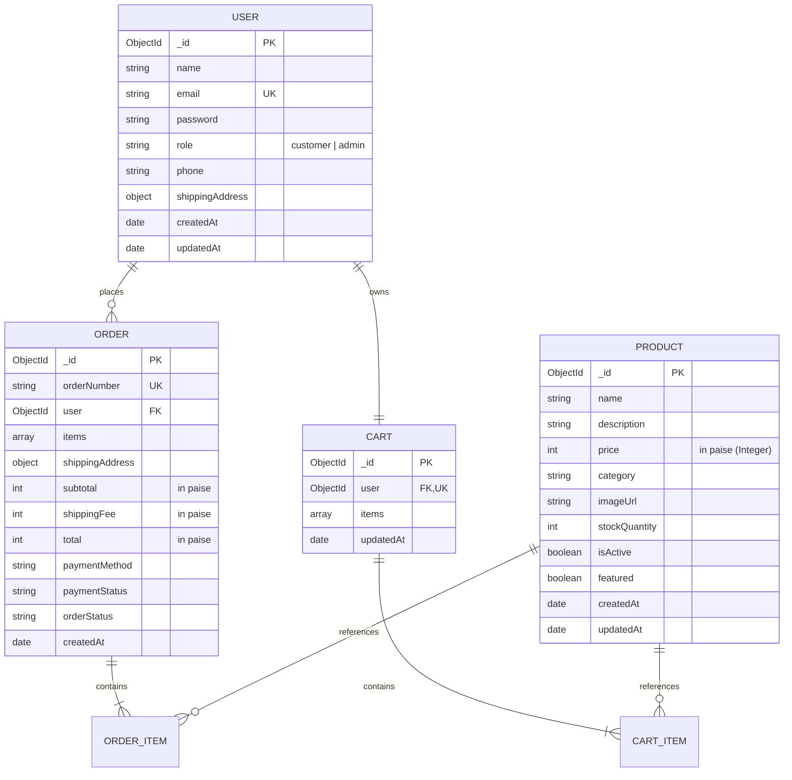

# ShopEasy — Database Design & Data Architecture

This document outlines the MongoDB schema design, relationships, indexing strategies, and constraints implemented using Mongoose for **ShopEasy**.

---

## 1. Entity-Relationship (ER) Diagram



---

## 2. Models & Schema Definitions

### 1. User Model (`backend/models/User.js`)
Stores customer and administrator profiles.

| Field | Type | Rules & Constraints | Description |
|---|---|---|---|
| `_id` | ObjectId | Auto-generated PK | Unique identifier |
| `name` | String | Required, Trim, Max: 100 | Customer's full name |
| `email` | String | Required, Unique, Lowercase, Trim | Normalized email address |
| `password` | String | Required, Min: 6, `select: false` | Hashed password (Bcryptjs, 10 rounds) |
| `role` | String | Enum: `['customer', 'admin']`, Default: `'customer'` | Authorization level |
| `phone` | String | Optional, Trim | Contact telephone number |
| `shippingAddress` | Object | Sub-document `{ street, city, state, postalCode, country }` | Default delivery address |
| `createdAt` / `updatedAt` | Date | Managed by Mongoose | Timestamps |

**Key Indexes:**
- Unique Index: `{ email: 1 }` (guarantees no two users register with the same email).

---

### 2. Product Model (`backend/models/Product.js`)
Authoritative source of catalog items, prices, and available inventory.

| Field | Type | Rules & Constraints | Description |
|---|---|---|---|
| `_id` | ObjectId | Auto-generated PK | Unique identifier |
| `name` | String | Required, Trim, Max: 150 | Product name |
| `description` | String | Required, Trim | Product description |
| `price` | Number (Integer) | Required, Min: 0, Integer validator | Price in **paise** (₹1 = 100 paise) |
| `category` | String | Required, Trim, Indexed | Product category (e.g. Electronics) |
| `imageUrl` | String | Required, Trim | Web image URL |
| `stockQuantity` | Number (Integer) | Required, Min: 0, Default: 0 | Current inventory count |
| `isActive` | Boolean | Default: `true`, Indexed | Soft deletion flag |
| `featured` | Boolean | Default: `false`, Indexed | Showcase flag for homepage |

**Key Indexes:**
- Compound Text Index: `{ name: 'text', description: 'text' }` (empowers fast keyword search).
- Single Field Index: `{ category: 1 }` (accelerates category filtering).
- Single Field Index: `{ isActive: 1 }` (filters out deactivated items).

---

### 3. Cart Model (`backend/models/Cart.js`)
Persists active shopping items for authenticated users across devices and logins.

| Field | Type | Rules & Constraints | Description |
|---|---|---|---|
| `_id` | ObjectId | Auto-generated PK | Unique identifier |
| `user` | ObjectId | Ref: `'User'`, Required, Unique | One cart per registered user |
| `items` | Array | Sub-documents `[{ product, quantity }]` | Cart items array |
| `items.product` | ObjectId | Ref: `'Product'`, Required | Referenced product ID |
| `items.quantity`| Number (Integer) | Required, Min: 1, Max: 50 | Units of product requested |

**Integrity Rule:**
The `addItem` instance method merges duplicate product entries instead of creating multiple rows for the same product ID.

---

### 4. Order Model (`backend/models/Order.js`)
Immutable historical record of completed purchases.

| Field | Type | Rules & Constraints | Description |
|---|---|---|---|
| `_id` | ObjectId | Auto-generated PK | Unique identifier |
| `orderNumber` | String | Required, Unique, Indexed | Human-readable ID (e.g. `SE-20261028-4821`) |
| `user` | ObjectId | Ref: `'User'`, Required, Indexed | Customer who placed the order |
| `items` | Array | Sub-documents `[{ product, name, price, quantity, subtotal, imageUrl }]` | Snapshot of purchased items |
| `shippingAddress` | Object | Required `{ fullName, phone, street, city, state, postalCode, country }` | Delivery destination |
| `subtotal` | Number | Required, Min: 0 | Total price of items in paise |
| `shippingFee` | Number | Required, Min: 0 | Shipping cost in paise |
| `total` | Number | Required, Min: 0 | Final payable sum (`subtotal + shippingFee`) |
| `paymentMethod`| String | Enum: `['cash_on_delivery', 'demo_checkout']` | Payment channel |
| `paymentStatus`| String | Enum: `['pending', 'completed', 'refunded']` | Payment fulfillment state |
| `orderStatus`  | String | Enum: `['placed', 'processing', 'shipped', 'delivered', 'cancelled']` | Shipping timeline state |

**Price Snapshot Design Pattern:**
Notice that `items` inside an `Order` stores `name`, `price`, and `subtotal` as independent values rather than only referencing the `Product` document. If an administrator later alters a product's price or description in the catalog, historical orders remain unaffected.

---

## 3. Storage Strategy: Integer Paise vs. Rupees

### Why Floating-Point Floats Fail
In standard JavaScript:
```js
0.1 + 0.2 === 0.30000000000000004 // TRUE!
```
In an e-commerce platform, adding tax, fractional discounts, or multiplying quantities with decimal floats causes rounding drift (e.g., losing or gaining 1 paisa across invoices).

### How ShopEasy Solves This
1. **At the Database Layer:** All monetary fields (`price`, `subtotal`, `shippingFee`, `total`) are strictly enforced as integers representing paise.
   - ₹1,499.00 is stored as `149900`
   - ₹99.00 standard delivery is stored as `9900`
   - ₹2,000.00 free shipping threshold is stored as `200000`
2. **At the Business Logic Layer:** All additions and multiplications are pure integer calculations.
3. **At the Presentation Layer:** The frontend utility `formatCurrency(paise)` converts paise to formatted rupees (`₹1,499.00`) using native `Intl.NumberFormat('en-IN')`.
