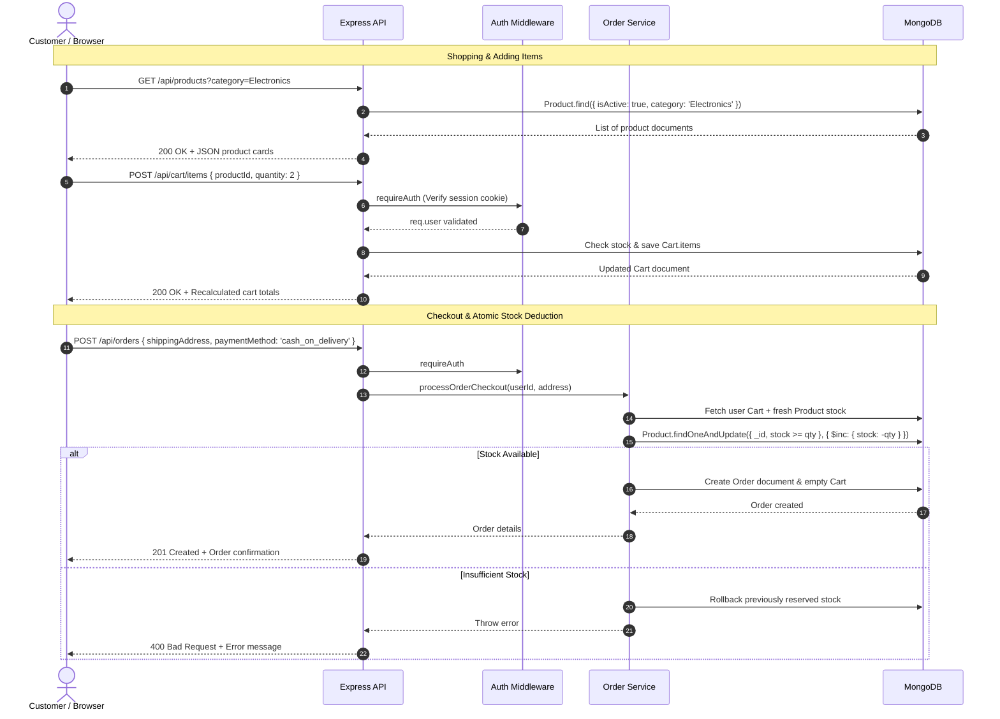

# ShopEasy — Detailed Project Explanation & Architecture Guide

Welcome to the comprehensive technical documentation for **ShopEasy**, built for the **CodeAlpha Full Stack Development Internship (Task 1: Simple E-Commerce Store)**.

This guide is designed specifically for aspiring full-stack engineers and interns to understand every layer of the architecture, explain the implementation decisions confidently during internship presentations, and master core web development concepts.

---

## 1. Project High-Level Overview

ShopEasy is a production-grade full-stack e-commerce web application. It delivers a modern, responsive online shopping experience while enforcing server-side business rules, atomic stock updates, session security, and database persistence.

### Key Functional Highlights
- **Product Catalog:** Dynamic product catalog with category chips, keyword search, price sorting, stock badges, and detailed specification views.
- **Shopping Cart:** Real-time cart management with quantity controls, unit price calculations, item deletion, and live free shipping progress calculation.
- **User Authentication:** Registration and login secured by `bcryptjs` password hashing, persistent `express-session` cookies (`HttpOnly`), and email normalization.
- **Secure Checkout:** Demonstration Cash-on-Delivery checkout enforcing complete server-side price recalculation and atomic inventory deduction.
- **Order Management:** Unique human-readable order numbers (`SE-YYYYMMDD-XXXX`), purchase-time price snapshots, order tracking, and itemized customer receipts.
- **Admin Control Panel:** Role-protected administrative dashboard to add products, adjust live stock levels, deactivate items, and update customer order statuses.

---

## 2. Technology Stack & Architectural Decisions

```
+-------------------------------------------------------------+
|                        CLIENT (Browser)                     |
|  Plain HTML5 • CSS3 (Custom Properties) • Vanilla JS Fetch  |
+-------------------------------------------------------------+
                               |
                   HTTP / JSON (Single Origin)
                   HttpOnly Session Cookies
                               v
+-------------------------------------------------------------+
|                     SERVER (Express.js)                     |
|  Helmet (CSP) • CORS • Sessions • Rate Limiter • Routers     |
|                                                             |
|   [Controllers] <---> [Services] <---> [Mongoose Models]   |
+-------------------------------------------------------------+
                               |
                     MongoDB Protocol (TCP)
                               v
+-------------------------------------------------------------+
|                     DATABASE (MongoDB)                      |
|       Users  •  Products  •  Carts  •  Orders  •  Sessions   |
+-------------------------------------------------------------+
```

### Why This Tech Stack Was Chosen

1. **Frontend: Pure Vanilla HTML5, CSS3, & JavaScript (ES6+)**
   - *Why not React or Vue?* Learning full-stack fundamentals requires mastering DOM manipulation, native browser events, state synchronization, and the native `fetch()` API without the abstraction layers of single-page application (SPA) frameworks.
   - *Single-Origin Static Serving:* Express serves the frontend directly via `express.static()`. This simplifies deployment and eliminates Cross-Origin Resource Sharing (CORS) complications for `HttpOnly` session cookies.

2. **Backend: Node.js & Express.js**
   - *Node.js* provides an asynchronous, non-blocking event-driven runtime ideal for I/O-heavy web stores.
   - *Express.js* delivers a minimalistic, unopinionated routing pipeline that clearly separates routes, controllers, services, and middleware.

3. **Database: MongoDB & Mongoose**
   - *MongoDB* is a document database that natively stores structured JSON-like BSON documents. It accommodates rich shopping carts and nested order line items naturally.
   - *Mongoose* enforces strict schemas, validation rules, field normalization hooks, and compound indexes on top of flexible documents.

4. **Monetary Precision: Integer Paise Storage**
   - *Problem:* JavaScript numbers are IEEE 754 double-precision floating-point values. Calculating prices like `0.1 + 0.2` produces `0.30000000000000004`, leading to catastrophic rounding discrepancies in financial systems.
   - *Solution:* All prices and fees are stored as **integer paise** (e.g. ₹1,499.00 is stored as `149900`). The server performs integer addition/multiplication, and values are converted to rupees only for display (`paise / 100`).

---

## 3. End-to-End System Workflow

### System Architecture Diagram (Mermaid)



---

## 4. Fundamental Full-Stack Concepts Explained

### 1. Client vs. Server
- The **Client** (frontend) runs inside the user's web browser on their laptop or mobile phone. It renders visual elements (HTML/CSS) and responds to user interactions (clicks, keyboard input).
- The **Server** (backend) runs in a secure environment. It executes business logic, interacts with the database, hashes passwords, validates permissions, and sends responses back to clients.

### 2. REST API & HTTP Methods
A **REST (Representational State Transfer)** API standardizes communication between frontend and backend using HTTP:
- `GET`: Read data (e.g. `GET /api/products`). Never alters server state.
- `POST`: Create a new resource (e.g. `POST /api/auth/register`, `POST /api/orders`).
- `PATCH`: Partially update an existing resource (e.g. `PATCH /api/cart/items/:id`, `PATCH /api/admin/orders/:id/status`).
- `DELETE`: Remove a resource (e.g. `DELETE /api/cart/items/:id`).

### 3. Authentication vs. Authorization
- **Authentication (AuthN):** "Who are you?" Verifying user identity through credentials (e.g. email and password matching the stored hash). Handled by `authController.login`.
- **Authorization (AuthZ):** "What are you allowed to do?" Verifying user permissions (e.g. ensuring only accounts with `role: 'admin'` can access `/api/admin/*`, and regular users can only read their own orders). Handled by `requireAdmin` and ownership checks.

### 4. Sessions vs. Cookies
- **Session Identifier Cookie:** A small cryptographic token (`connect.sid`) stored by the browser. It contains no personal information. Marked with `HttpOnly` (inaccessible to malicious JavaScript, preventing XSS token theft).
- **Server-Side Session Store:** The actual user data (`req.session.userId`, `req.session.role`) stored securely in MongoDB (`connect-mongo`). When a request arrives, Express reads the cookie, finds the session in MongoDB, and knows who is making the request.

---

## 5. File-by-File Code Walkthrough

| File Path | Role & Purpose | Key Highlights |
|---|---|---|
| `backend/server.js` | Server entrypoint | Connects to DB, starts HTTP listener, binds graceful shutdown handlers (`SIGINT`, `SIGTERM`), and auto-populates sample data if empty. |
| `backend/app.js` | Express app configuration | Configures Helmet security headers, CORS, body parsers, persistent Mongo sessions, API routes, static file serving, and 404 handler. |
| `backend/config/database.js` | Database connection manager | Smart connection manager: probes local port 27017; if absent in development, seamlessly boots embedded `mongodb-memory-server`. |
| `backend/models/User.js` | User schema & model | Enforces unique normalized email, hides password by default (`select: false`), and automatically hashes passwords with `bcryptjs`. |
| `backend/models/Product.js` | Product catalog schema | Stores prices in integer paise, includes compound text indexes on `name` and `description` for fast search, and exposes rupee virtuals. |
| `backend/models/Cart.js` | Cart persistence schema | Maps user to cart items, prevents duplicate product entries, and enforces positive integer quantities. |
| `backend/models/Order.js` | Order history schema | Snapshots product names and prices at purchase time to preserve historical order records regardless of future price changes. |
| `backend/services/orderService.js` | Core business logic | Calculates order totals and shipping fees (Free >= ₹2,000, else ₹99). Executes atomic inventory deduction and rollback logic. |
| `backend/middleware/requireAuth.js` | Authentication guard | Validates session existence and binds active `req.user` to request. |
| `backend/middleware/requireAdmin.js` | Authorization guard | Blocks non-admin users with 403 Forbidden. |
| `backend/middleware/errorHandler.js` | Central error handler | Catches validation errors, invalid ObjectIds, duplicate emails, and hides internal stack traces in non-development modes. |
| `frontend/js/api.js` | Unified API client | Reusable Fetch wrapper configured with `credentials: 'include'` for session persistence and normalized error extraction. |
| `frontend/js/app.js` | Global UI controller | Runs across all pages to update navbar auth states (user dropdown or login buttons) and update live cart item badges. |

---

## 6. How to Explain This Project in an Internship Interview

When presenting ShopEasy to CodeAlpha evaluators or interviewers, follow this structured breakdown:

1. **The Problem & Objective:**
   > *"For CodeAlpha Task 1, I built ShopEasy—a complete, functional e-commerce store with user registration, session management, catalog search and filtering, shopping cart persistence, and order processing."*

2. **Database & Financial Precision:**
   > *"To avoid floating-point math bugs common in JavaScript, I architected the database to store all monetary values as integer paise. ₹1,499 is stored as 149,900 paise. The server performs all additions and multiplications as integers and formats to rupees only for display."*

3. **Security Measures:**
   > *"I prioritized security: passwords are salted and hashed using bcryptjs. Authentication uses server-side sessions with HttpOnly cookies, protecting against XSS attacks. State-changing cart and checkout operations recalculate all prices directly on the server to prevent client-side price tampering."*

4. **Inventory Integrity & Race Conditions:**
   > *"To prevent overselling, our order service performs atomic conditional updates (`findOneAndUpdate with $gte: quantity`). If two customers attempt to buy the last remaining item simultaneously, the database guarantees that only one will succeed, and the second customer receives an out-of-stock notification without corrupted inventory."*

5. **Automated Testing:**
   > *"The project includes 17 automated integration and unit tests using Jest and Supertest, covering user registration, login, catalog search, sorting, cart calculations, shipping thresholds, and order authorization."*
